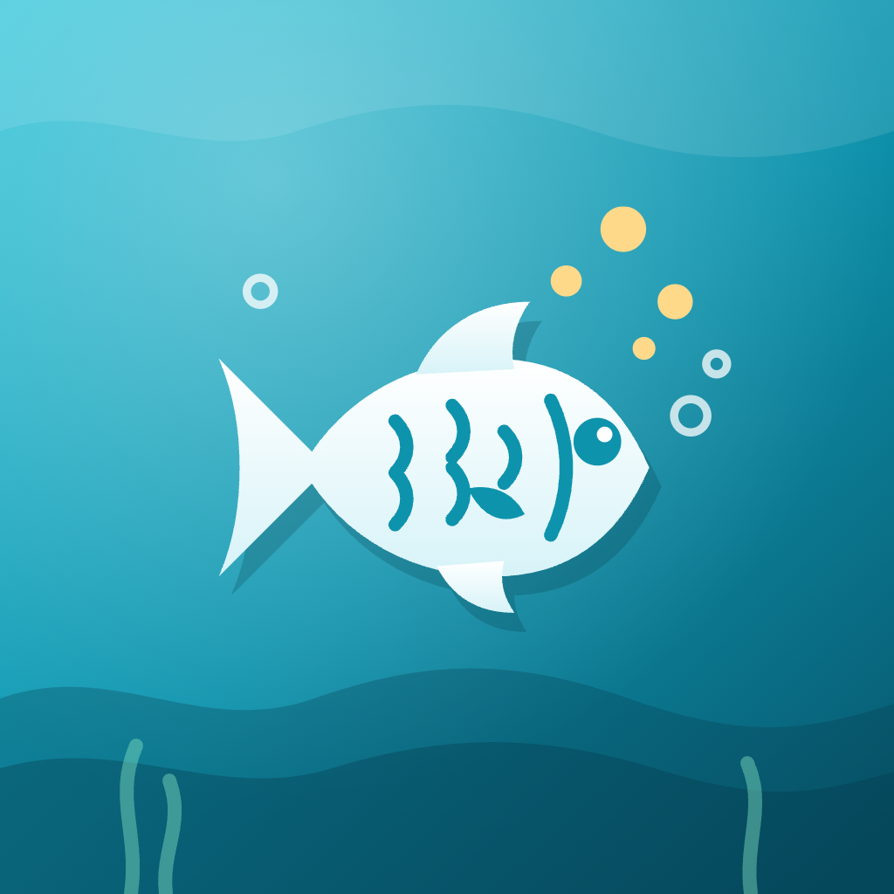
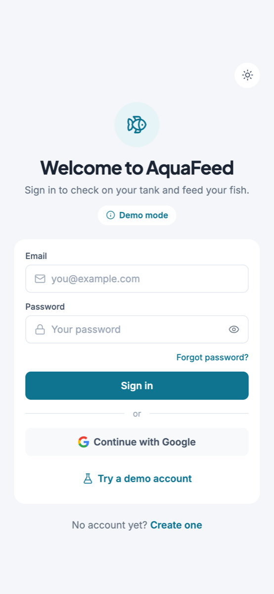
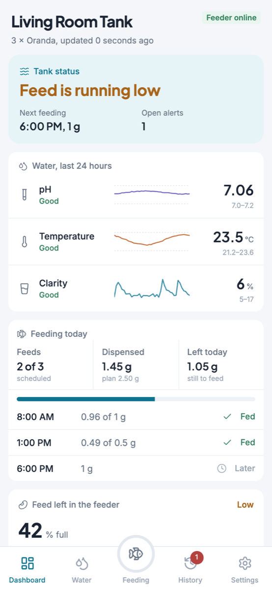
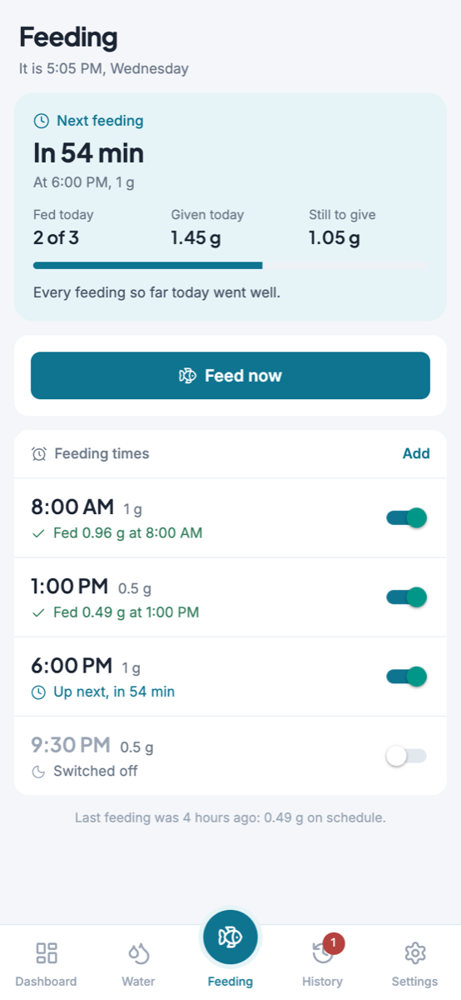
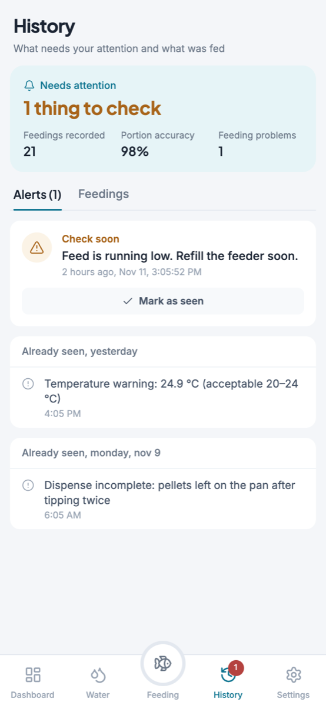
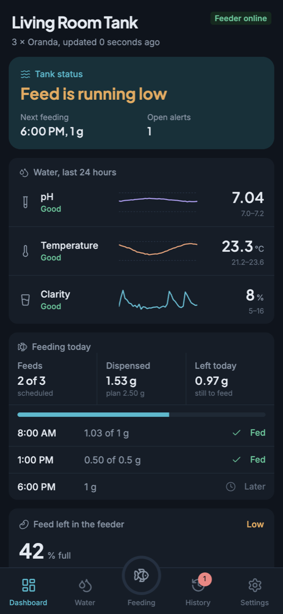
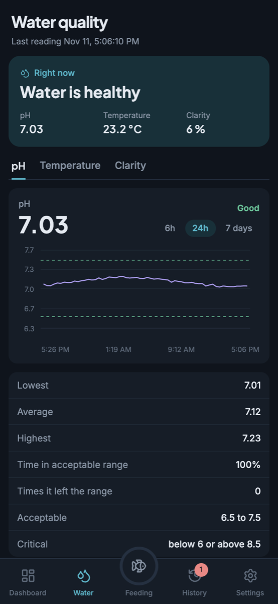
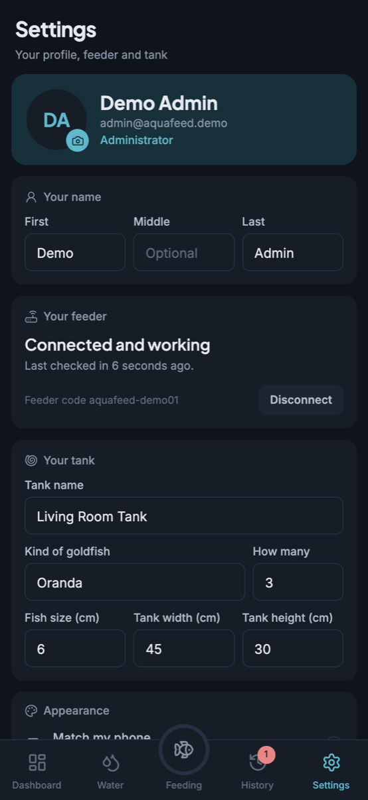

<p align="center">
  
</p>

<h1 align="center">AquaFeed</h1>

<p align="center">
  Mobile app for an automatic fish feeder with water-quality monitoring.
</p>

## Screenshots

<p align="center">
  
  
  
  
</p>
<p align="center">
  
  
  
</p>

## What it does

- **Dashboard:** tank status at a glance, with water readings, today's feedings, feed left in the feeder and open alerts.
- **Water:** pH, temperature and clarity with history charts, time in range and recent readings.
- **Feeding:** a countdown to the next feeding, today's results, feeding times you can add, edit and switch off, and a "Feed now" button.
- **History:** alerts to check and a day-by-day log of every feeding.
- **Settings:** profile and photo, feeder connection, tank details, light or dark appearance, and alerts on your phone.
- **Administrators:** manage people, alert limits and sensor calibration.

It works offline with the last synced data, and has a demo mode with sample data so you can try everything without any hardware.

## Built with

Expo and React Native (TypeScript), Expo Router, NativeWind (Tailwind CSS), Firebase Realtime Database and Authentication, Zustand, React Hook Form with Zod, and Lucide icons.

## Getting started

```sh
npm install
npx expo start
```

Press `w` to open it in a browser, or scan the QR code with Expo Go on your phone.

With no configuration the app starts in **demo mode**. Tap "Try a demo account" on the sign-in screen to explore with sample data.

### Connecting to Firebase

1. Create a Firebase project and turn on Realtime Database and Authentication (email/password and Google).
2. Copy `.env.example` to `.env` and fill in your project's web app values.
3. Restart with `npx expo start --clear`.

Google sign-in, push alerts and the photo picker use native code, so they need a development build (`npx expo run:android` or an EAS build) rather than Expo Go.

## Live updates

Updates are required and automatic: when a new version is published, the installed app shows an "Updating" screen with download progress and then restarts into it by itself. Nobody has to reinstall.

Updates are hosted on GitHub Pages, with no extra service or account:

1. Build and install the Android app once (`npx expo run:android --variant release`).
2. Push to `main`. The **Publish app update** workflow exports the app and publishes it to Pages.
3. Installed apps pick it up the next time they open.

Things to know:

- Updates can change screens, text and logic. Adding a library with native code, or changing the app version, needs a new build.
- The update is built by the workflow, so it needs the same settings as your build. Add your `EXPO_PUBLIC_*` values as repository secrets; without them the update runs in demo mode.
- To host updates somewhere else, set `UPDATES_URL` when building the app.

## Scripts

```sh
npx expo start      # run the app
npx tsc --noEmit    # typecheck
npx eslint src      # lint
```

## License

[Apache 2.0](LICENSE)
